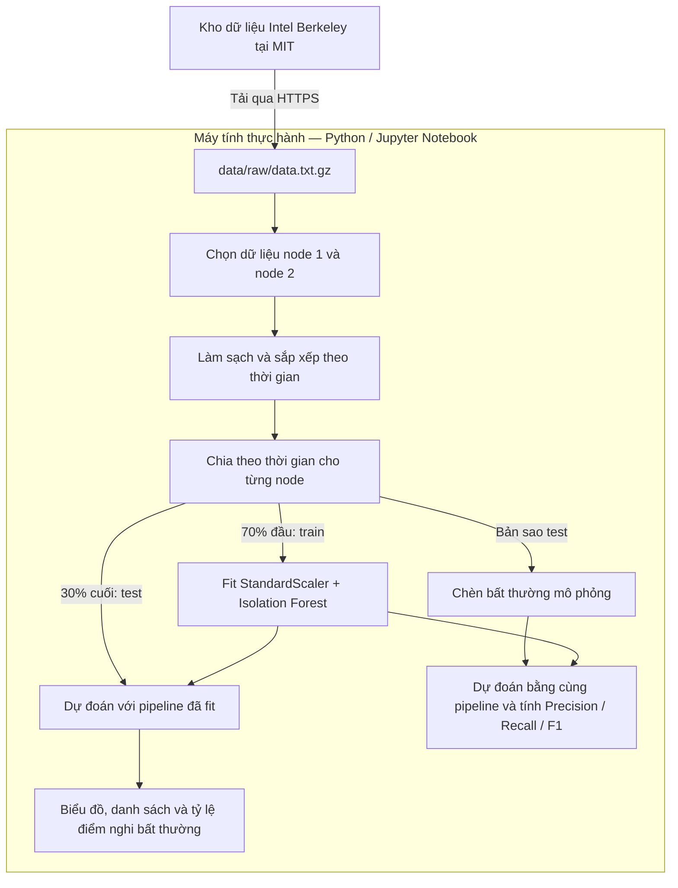

# Phát hiện bất thường trong dữ liệu cảm biến IoT bằng Isolation Forest

Notebook `intel_iot_isolation_forest.ipynb` thực hiện quy trình từ dữ liệu Intel Berkeley Research Lab thô đến làm sạch, huấn luyện, trực quan hóa và xuất các điểm nghi bất thường. Mặc định dùng node **1 và 2**, so sánh **nhiệt độ** với **nhiệt độ + điện áp**.

Đã chạy thành công toàn bộ notebook trên dữ liệu thật với cấu hình mặc định. Xem [kết quả và nhận xét lần chạy kiểm chứng](KET_QUA.md); notebook đã lưu sẵn bảng và biểu đồ để đọc ngay.

## Topology triển khai

Bài thực hành xử lý offline, tập trung trên một máy tính. Node 1 và 2 là các node được chọn trong dữ liệu lưu trữ. Các mũi tên dưới đây biểu diễn luồng dữ liệu; sơ đồ không xác định các liên kết vô tuyến của mạng cảm biến gốc.



Mỗi node chạy hai pipeline độc lập: **nhiệt độ** và **nhiệt độ + điện áp**; mặc định có tổng cộng bốn mô hình. Scaler và Isolation Forest chỉ học từ train. Toàn bộ quá trình phân tích chạy cục bộ sau khi tải dữ liệu; triển khai hiện tại không cần cảm biến thật, gateway hay MQTT broker.

## Chạy notebook

Cần Python **3.11 trở lên** (notebook dùng `hashlib.file_digest`). Mở PowerShell tại thư mục dự án rồi chạy:

```powershell
python -m venv .venv
.\.venv\Scripts\python.exe -m pip install -r requirements.txt
.\.venv\Scripts\python.exe -m jupyterlab intel_iot_isolation_forest.ipynb
```

Chọn kernel Python của môi trường `.venv`, đọc ô cấu hình rồi chọn **Run → Run All Cells**. Giữ thư mục làm việc là thư mục dự án. Có thể thay node và các tham số trong ô cấu hình rồi chạy lại toàn bộ notebook. Giữ hai cấu hình `temperature: ["temperature"]` và `temperature_voltage: ["temperature", "voltage"]` vì các ô so sánh, kiểm tra mô phỏng và xem xét thủ công dùng các tên/ý nghĩa này. Có thể thêm cấu hình thứ ba, chẳng hạn `temperature_humidity: ["temperature", "humidity"]`; khi đó mọi cấu hình sẽ dùng cùng những dòng đủ tất cả đặc trưng đã chọn.

Lần đầu cần Internet để tải dữ liệu vào `data/raw/data.txt.gz`; các lần sau dùng bản đã lưu. Tệp tải xuống chỉ được đổi thành tên đích sau khi hoàn tất. Nếu tải tự động thất bại, tải `data.txt.gz` từ [trang Intel Lab Data](https://db.csail.mit.edu/labdata/labdata.html), đặt đúng đường dẫn trên rồi chạy lại. Giữ nguyên tệp thô: **dấu phân cách là một dấu cách**, cần bảo toàn các cột trống; thay bằng phép tách mọi khoảng trắng có thể làm lệch cột.

## Thiết kế thí nghiệm

- Làm sạch giá trị thiếu/không đọc được, loại bản ghi trùng và sắp xếp theo thời gian. Hai cấu hình dùng cùng những dòng có đủ nhiệt độ và điện áp để so sánh công bằng. Không loại các giá trị cực đoan hữu hạn chỉ vì chúng khác thường.
- Với từng node, dùng 70% dữ liệu đầu theo thời gian để huấn luyện, 30% cuối để đánh giá. `StandardScaler` và `IsolationForest` chỉ được fit trên tập huấn luyện. Các bản ghi dự đoán giữ thông tin thuộc tập nào.
- Mặc định: `n_estimators=200`, `contamination=0.02`, `random_state=42`. `contamination` là giả định đặt ngưỡng, không phải tỷ lệ lỗi đã biết. Tỷ lệ gắn cờ trên tập huấn luyện chịu ảnh hưởng trực tiếp của tham số này.
- Chuẩn hóa đáp ứng quy trình thực hành; không nên suy ra rằng cây Isolation Forest luôn cần chuẩn hóa. Mô hình dùng giá trị tại từng thời điểm, chưa học quan hệ tuần tự giữa các thời điểm.
- Thí nghiệm bán tổng hợp thêm đột biến nhiệt độ theo hai chiều và sụt điện áp vào **bản sao tập đánh giá**. Dùng cùng các điểm chèn cho hai cấu hình, giữ nguyên mô hình đã huấn luyện và không điều chỉnh tham số theo kết quả đánh giá.

## Kết quả được lưu

Notebook đọc dữ liệu và xuất kết quả theo cấu trúc sau:

```text
NT120/
├── intel_iot_isolation_forest.ipynb  # Cấu hình, xử lý, huấn luyện và đánh giá
├── requirements.txt
├── README.md
├── KET_QUA.md
├── data/raw/                        # Dữ liệu đầu vào
└── outputs/
    ├── data_checks/                 # cleaning_report.csv, node_profile.csv
    ├── predictions/                 # predictions.csv, anomalies.csv, anomaly_summary.csv
    ├── evaluation/                  # So sánh đặc trưng, mô phỏng và rà soát thủ công
    │   └── figures/                 # Biểu đồ chuỗi thời gian và đánh giá
    └── run_metadata.json            # Tham số và phiên bản thư viện của lần chạy
```

Chạy lại notebook sẽ cập nhật các kết quả. Riêng `outputs/evaluation/manual_review.csv`
chỉ được tạo nếu chưa tồn tại để giữ nhận xét đã điền. Nếu đổi node hoặc cấu hình
và cần mẫu mới, hãy đổi tên bản cũ trước khi chạy lại.

## Đọc kết quả đúng phạm vi

Dữ liệu gốc không có nhãn xác nhận bất thường. Một điểm được gắn cờ chỉ là **điểm nghi bất thường**, chưa chứng minh cảm biến hỏng. Kiểm tra cửa sổ thời gian quanh điểm đó, đối chiếu nhiệt độ/điện áp, đồng thời xem cả các điểm đối chứng và ghi nhận xét vào các cột trống trong `outputs/evaluation/manual_review.csv`.

Precision, Recall và F1 chỉ mô tả **thí nghiệm bán tổng hợp**, với giả định các điểm không bị chèn là âm tính. Dữ liệu nền có thể đã chứa bất thường thực, nên các chỉ số này không phải độ chính xác phát hiện lỗi ngoài thực tế. Mô hình chỉ dùng nhiệt độ không thể quan sát trực tiếp một thay đổi chỉ xảy ra ở điện áp; cần đọc kết quả theo từng loại chèn. Không kết luận cấu hình nhiều đặc trưng tốt hơn chỉ vì phát hiện nhiều điểm hơn.

## Nguồn

- [Intel Lab Data — MIT CSAIL](https://db.csail.mit.edu/labdata/labdata.html): ghi nhận đóng góp của Peter Bodik, Wei Hong, Carlos Guestrin, Sam Madden, Mark Paskin, Romain Thibaux và Intel Berkeley. Dữ liệu gồm nhiệt độ, độ ẩm, ánh sáng và điện áp từ mạng cảm biến; trang nguồn lưu ý điện áp có tương quan với nhiệt độ.
- [Tài liệu IsolationForest](https://scikit-learn.org/stable/modules/generated/sklearn.ensemble.IsolationForest.html): tham số, điểm số và nhãn dự đoán.
- [Tránh rò rỉ dữ liệu — scikit-learn](https://scikit-learn.org/stable/common_pitfalls.html#data-leakage): tách dữ liệu trước khi học các phép biến đổi.
